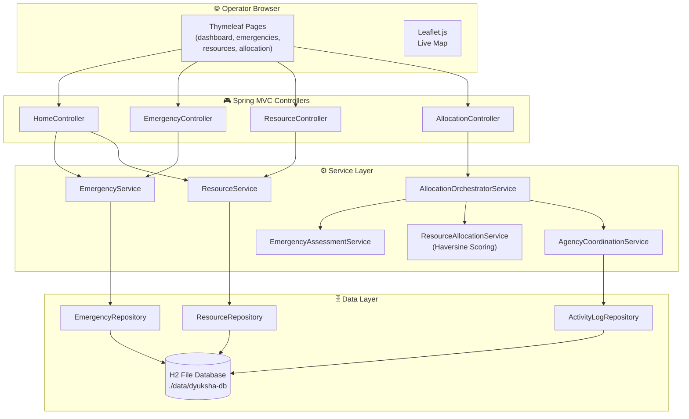

<div align="center">

```
██████╗ ██╗   ██╗██╗   ██╗██╗  ██╗███████╗██╗  ██╗ █████╗
██╔══██╗╚██╗ ██╔╝██║   ██║██║ ██╔╝██╔════╝██║  ██║██╔══██╗
██║  ██║ ╚████╔╝ ██║   ██║█████╔╝ ███████╗███████║███████║
██║  ██║  ╚██╔╝  ██║   ██║██╔═██╗ ╚════██║██╔══██║██╔══██║
██████╔╝   ██║   ╚██████╔╝██║  ██╗███████║██║  ██║██║  ██║
╚═════╝    ╚═╝    ╚═════╝ ╚═╝  ╚═╝╚══════╝╚═╝  ╚═╝╚═╝  ╚═╝
```

### **AI-Native Multi-Agency Emergency Response System**

*Coordinate every unit. Every second. From one command center.*

---

[](https://adoptium.net/)
[](https://spring.io/projects/spring-boot)
[](https://maven.apache.org/)
[](https://www.h2database.com/)
[](https://www.docker.com/)
[](LICENSE)
[](#)
[](#-roadmap)

<br/>

**[⚡ Quick Start](#-quick-start)** · **[🚀 Features](#-features)** · **[🧠 AI Engine](#-ai-allocation-engine)** · **[🏗️ Architecture](#-architecture)** · **[🐳 Docker](#-docker)** · **[☁️ Deploy](#-deploying-to-render)**

</div>

---

## 🔥 What is Dyuksha?

> **Dyuksha** is a production-grade emergency operations command center that unifies police, fire services, hospitals, ambulances, and rescue teams under a single real-time dashboard — powered by an intelligent resource allocation engine.

When a flood hits, a building collapses, or a mass-casualty event unfolds, every second counts. Dyuksha gives incident commanders a **single pane of glass** to:

- 📍 **See** every emergency pinned on a live operational map
- 🔢 **Score** available resources using AI-weighted criteria
- ✅ **Approve** allocations before any unit is dispatched
- 📋 **Track** the full response lifecycle from "Reported" to "Resolved"

No automatic dispatch. No black-box decisions. **Human-in-the-loop, always.**

---

## ✨ Features

<table>
<tr>
<td width="50%">

### 🗺️ Live Operational Map
Real-time Leaflet map with CARTO dark tiles. Emergency incidents and deployed resources rendered as live markers with popups showing severity, type, and status.

</td>
<td width="50%">

### 🚨 Emergency Management
Full CRUD lifecycle — create, triage, assign, and resolve incidents. Severity levels (Critical → Low), 5-stage status workflow, and filterable incident list.

</td>
</tr>
<tr>
<td width="50%">

### 🚑 Multi-Agency Resources
25+ pre-seeded resources across 4 types: **Ambulances**, **Fire & Rescue Teams**, **Police Units**, and **Hospitals** (with bed capacity tracking).

</td>
<td width="50%">

### 🤖 AI Allocation Engine
Haversine-based distance calculation combined with 4-weight scoring to rank the best available resources for any emergency — with one-click operator approval.

</td>
</tr>
<tr>
<td width="50%">

### 📊 Command Center Dashboard
Live KPI cards (active emergencies, resources deployed, critical incidents), activity feed, and tabbed resource availability — all wired to real database state.

</td>
<td width="50%">

### 🔒 Human-in-the-Loop Control
Recommendations are presented, not executed. Every allocation requires explicit operator approval. The system never auto-dispatches a single unit.

</td>
</tr>
</table>

---

## 🧠 AI Allocation Engine

The allocation engine is a **pure Java** scoring system — no external AI APIs, no black box. It's designed with clean service interfaces ready for future LLM or agent integration.

### How the Score is Calculated

```
Final Score = Suitability(40%) + Distance(30%) + Severity(20%) + Availability(10%)
```

| Weight | Criterion | Description |
|:------:|-----------|-------------|
| **40%** | Suitability | Does the resource type match the emergency requirements? |
| **30%** | Distance | Haversine great-circle distance from resource to incident |
| **20%** | Severity | Higher severity emergencies attract better-matched resources |
| **10%** | Availability | Is the resource currently available vs. busy or offline? |

### Emergency Type → Required Resources

| Emergency | Primary Resources | Secondary |
|-----------|-----------------|-----------|
| 🌊 Flood | Rescue Teams, Police | Hospital |
| 🔥 Fire | Fire & Rescue | Ambulance, Police |
| 🏥 Medical Emergency | Ambulance | Hospital |
| 🏗️ Building Collapse | Fire & Rescue, Ambulance | Police, Hospital |
| 🚗 Road Accident | Ambulance, Police | Fire & Rescue |

### Service Architecture

```
AllocationOrchestratorService
├── EmergencyAssessmentService   → Determines resource requirements by type/severity
├── ResourceAllocationService    → Scores and ranks candidates using Haversine + weights
└── AgencyCoordinationService    → Logs assignments to ActivityLog on operator approval
```

> Each service is defined behind an interface — swap in an LLM agent or external AI later with zero controller changes.

---

## 🏗️ Architecture



---

## ⚡ Quick Start

**Prerequisites:** Java 21+ · Maven not required (wrapper included) · Docker (optional)

```bash
# 1. Clone the repository
git clone https://github.com/AfrazAhamed24/Dyuksha.git
cd Dyuksha
```

<details>
<summary>🪟 <strong>Windows PowerShell</strong></summary>

```powershell
# Check Java version first
java -version

# Run the application
.\mvnw.cmd spring-boot:run
```

</details>

<details>
<summary>🐧 <strong>macOS / Linux</strong></summary>

```bash
# Make wrapper executable
chmod +x mvnw

# Run the application
./mvnw spring-boot:run
```

</details>

**Then open → [http://localhost:8080](http://localhost:8080)** 🎉

The application seeds **25 resources** and **10 emergency incidents** automatically on first run.

---

## 🧭 Application Routes

| Route | Page | Description |
|-------|------|-------------|
| [`/`](http://localhost:8080/) | 📊 Dashboard | Live KPIs, operational map, incident feed, resource availability |
| [`/emergencies`](http://localhost:8080/emergencies) | 🚨 Emergencies | Browse, filter, and manage all incidents |
| [`/emergencies/new`](http://localhost:8080/emergencies/new) | ➕ New Incident | Report a new emergency |
| [`/resources`](http://localhost:8080/resources) | 🚑 Resources | Registry of all agencies and units |
| [`/allocation`](http://localhost:8080/allocation) | 🤖 Allocation | AI-powered resource recommendation console |
| [`/h2-console`](http://localhost:8080/h2-console) | 🗄️ Database | H2 console for local inspection |

---

## 🗃️ Database

Dyuksha uses a **file-based H2 database** — no external database setup required.

```properties
JDBC URL:  jdbc:h2:file:./data/dyuksha-db
Username:  dyuksha
Password:  (leave empty)
```

The database file persists at `./data/dyuksha-db.mv.db` and is excluded from Git. The `DataInitializer` bean seeds all sample data on first startup.

---

## 📁 Project Structure

```
Dyuksha/
├── 📄 pom.xml                           Maven build (Java 21, Spring Boot 3.3.5)
├── 🐳 Dockerfile                        Multi-stage production image
├── ⚙️  mvnw / mvnw.cmd                  Maven wrapper (no install needed)
│
├── backend/src/main/java/com/dyuksha/
│   ├── 🎮 controller/                   HomeController, EmergencyController,
│   │                                    ResourceController, AllocationController
│   ├── 🧠 service/                      EmergencyService, ResourceService,
│   │                                    AllocationOrchestratorService,
│   │                                    EmergencyAssessmentService,
│   │                                    ResourceAllocationService,
│   │                                    AgencyCoordinationService
│   ├── 🏛️  model/                       Emergency, Resource, ActivityLog + enums
│   ├── 📦 dto/                          AllocationPlan, AssessmentResult,
│   │                                    ResourceRecommendation, form DTOs
│   ├── 🗃️  repository/                  Spring Data JPA repositories
│   └── 🌱 config/DataInitializer.java   Seeds 25 resources + 10 emergencies
│
├── frontend/
│   ├── 🖼️  templates/                   Thymeleaf HTML pages + fragments
│   │   ├── dashboard.html
│   │   ├── emergencies.html
│   │   ├── emergency-detail.html
│   │   ├── resources.html
│   │   ├── resource-detail.html
│   │   ├── allocation.html
│   │   └── fragments/ (sidebar, topbar, head)
│   └── 🎨 static/
│       ├── css/ (dashboard.css, emergencies.css, allocation.css)
│       └── js/  (dashboard.js, emergencies.js)
│
└── data/                                H2 database files (Git-ignored)
```

<details>
<summary>🔍 <strong>Where do I make changes?</strong></summary>

| I want to change... | Edit this... |
|---------------------|-------------|
| A page layout or content | `frontend/templates/` |
| Styling / design system | `frontend/static/css/` |
| Map or dashboard behavior | `frontend/static/js/dashboard.js` |
| Routes and HTTP handling | `backend/.../controller/` |
| Business or allocation logic | `backend/.../service/` |
| Database schema / entities | `backend/.../model/` |
| Sample data / seed data | `backend/.../config/DataInitializer.java` |
| App settings (port, DB) | `backend/src/main/resources/application.properties` |

</details>

---

## ⚙️ Configuration

```properties
# application.properties
server.port=${PORT:8080}
spring.datasource.url=jdbc:h2:file:./data/dyuksha-db;AUTO_SERVER=TRUE
spring.datasource.username=${DB_USERNAME:dyuksha}
spring.datasource.password=${DB_PASSWORD:}
spring.h2.console.enabled=true
```

| Variable | Default | Description |
|----------|---------|-------------|
| `PORT` | `8080` | HTTP server port |
| `DB_USERNAME` | `dyuksha` | H2 database username |
| `DB_PASSWORD` | *(empty)* | H2 database password |

---

## 🐳 Docker

```bash
# Build the image
docker build -t dyuksha .

# Run on default port 8080
docker run --rm -p 8080:8080 dyuksha

# Run on a custom port
docker run --rm -e PORT=9090 -p 9090:9090 dyuksha
```

---

## ☁️ Deploying to Render

<details>
<summary>🐳 <strong>Docker deployment (recommended)</strong></summary>

1. Create a new **Web Service** in [Render](https://render.com)
2. Connect this repository
3. Select **Docker** as the runtime
4. Click **Deploy**

Render injects `PORT` automatically — the app reads it via `server.port=${PORT:8080}`.

> [!IMPORTANT]
> Render's filesystem is **ephemeral**. Configure a **Persistent Disk** mounted at `./data/` if you need the H2 database to survive redeployments.

</details>

<details>
<summary>☕ <strong>Maven (JAR) deployment</strong></summary>

| Setting | Value |
|---------|-------|
| Runtime | Java |
| Build command | `./mvnw clean package -DskipTests` |
| Start command | `java -jar target/dyuksha-0.1.0-SNAPSHOT.jar` |

</details>

---

## 🧪 Build & Test

```bash
# Run all tests
./mvnw test                        # macOS/Linux
.\mvnw.cmd test                    # Windows

# Package a runnable JAR
./mvnw clean package               # macOS/Linux
.\mvnw.cmd clean package           # Windows

# Run the JAR directly
java -jar target/dyuksha-0.1.0-SNAPSHOT.jar
```

---

## 🛣️ Roadmap

| Phase | Feature | Status |
|-------|---------|--------|
| **Phase 1** | Spring Boot foundation, Maven, H2, project scaffold | ✅ Complete |
| **Phase 2** | Dark design system, responsive shell, dashboard UI | ✅ Complete |
| **Phase 3** | Emergency management (CRUD, lifecycle, map markers) | ✅ Complete |
| **Phase 4** | Resource management (25 units, 4 types, assignment workflow) | ✅ Complete |
| **Phase 5** | AI allocation engine (Haversine, weighted scoring, activity log) | ✅ Complete |
| **Phase 6** | WebSocket live updates, push notifications | 🔜 Planned |
| **Phase 7** | Multi-tenant agency authentication, role-based access | 🔜 Planned |
| **Phase 8** | LLM agent integration (replace Java scoring with AI reasoning) | 🔜 Planned |

---

## 🛠️ Technology Stack

| Layer | Technology |
|-------|-----------|
| Language | Java 21 (LTS) |
| Framework | Spring Boot 3.3.5 |
| Web / MVC | Spring MVC + Thymeleaf |
| Persistence | Spring Data JPA + H2 (file-based) |
| Build | Maven 3.9 + Maven Wrapper |
| Map | Leaflet.js + CARTO Dark Matter tiles |
| Containerization | Docker (multi-stage build) |
| Hosting | Render (Docker or JAR) |
| Scoring | Haversine formula + 4-weight ranking |

---

<div align="center">

**Built for responders. Designed for clarity. Engineered for speed.**

*Dyuksha — because in an emergency, the right resource at the right time saves lives.*

---

📜 **Proprietary** — All rights reserved · © 2024 Afraz Ahamed

</div>
